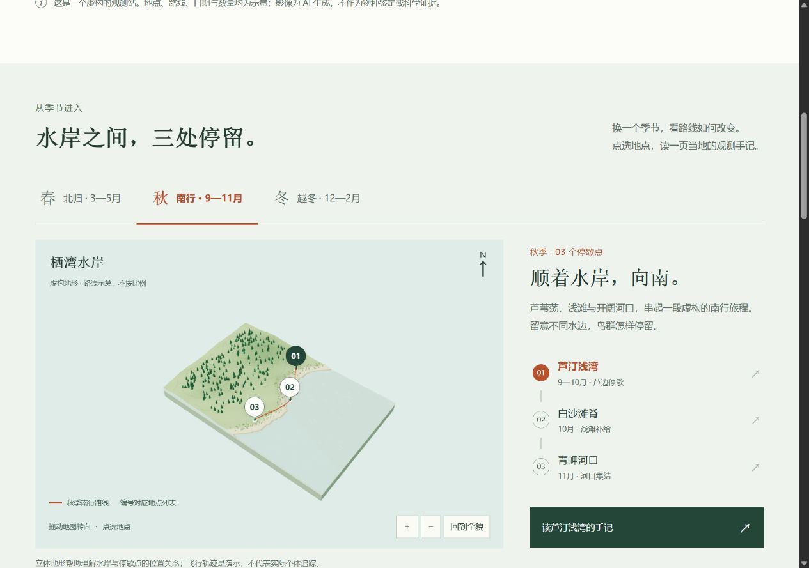
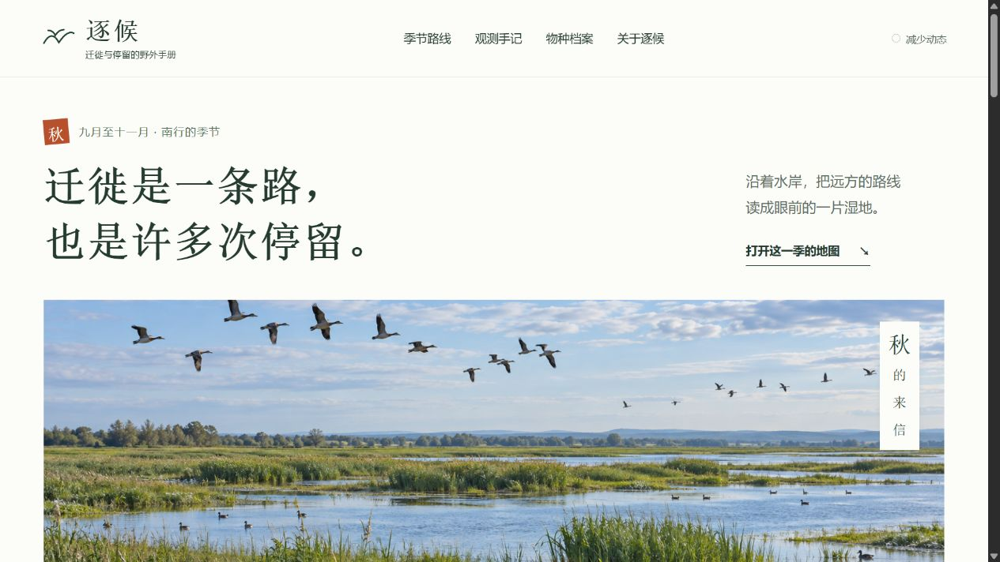

# Adaptive Frontend Design · 自适应前端设计

**让内容决定网页表达，把版式、动效、3D 和真实使用路径接起来。**

[English](README.md) · [安装](#安装) · [完整示例](#完整示例) · [参与改进](CONTRIBUTING.md)



这是一份给编码智能体使用的设计 Skill。先理解读者、内容、主要动作与品牌，再选择功能阅读、编辑策展、动效叙事、局部3D或交互世界。不同任务可以采用不同结构，已有认可的小修不重新设计整站。

## 它解决什么

- **网站越做越像**：比较版式骨架、字体节奏、文案与主要交互，而不只换题材和配色。
- **页面太挤或太空**：按分组、主次与阅读距离判断疏密，不统一加大留白。
- **动效各自演示**：把输入、可见变化、阅读、打断和返回接成完整过程。
- **3D与内容脱节**：让镜头和场景呈现正文所说的关系，保留直接入口与稳定阅读。
- **按钮只有一种外形**：按导航、命令、选值、设置、媒体和空间操作选择形式。
- **局部能用，整站断开**：检查真实鼠标/键盘、详情和历史、重排、退路、焦点与减少动态。

它是可复用的指导，不是组件库或保证质量的网站生成器。Skill本身无需API密钥或服务；实际制作仍需要项目材料、实现工具、合适素材与实屏检查能力。

## 安装

在目标项目中运行：

```sh
npx skills add zthagyamin/adaptive-frontend-design --skill adaptive-frontend-design
```

按提示选择智能体。社区 [Skills CLI](https://github.com/vercel-labs/skills) 当前要求 Node.js 22.20+，提供多种宿主的安装路径；本项目的实际制作经验来自 Codex，不声称所有平台都已独立验证。该CLI有自己的遥测说明与关闭方式。

也可以让Codex的 `$skill-installer` 安装：

```text
使用 $skill-installer，从下面地址安装 adaptive-frontend-design：
https://github.com/zthagyamin/adaptive-frontend-design/tree/main/skills/adaptive-frontend-design
```

手动方式：复制整个 `skills/adaptive-frontend-design` 文件夹到目标项目的 `.agents/skills/`。Codex用户范围可放到 `~/.agents/skills/`。已有同名安装时先比较，避免重复加载或覆盖本地修改。[官方安装位置与格式](https://learn.chatgpt.com/docs/build-skills)。

根目录同时提供便携插件描述 `plugin.json`；公开仓库不代表已进入官方或通用插件目录。

## 怎么使用

```text
使用 $adaptive-frontend-design，为社区维修工坊做一个完整网站。
访客需要看懂服务、选择维修类别，并阅读到店前准备。
只问会改变设计的缺失信息，按目标读者使用中文，实际检查成品。
```

```text
使用 $adaptive-frontend-design，做一个完整迁徙观测手册。
用明确标注的虚构数据，把季节3D路线、地点、观测手记与类群档案接起来。
保留直接链接、稳定阅读、键盘操作与合理返回。
```

```text
使用 $adaptive-frontend-design，只改“保存筛选”按钮的状态反馈。
保留已认可的布局与现有保存逻辑，核对成功、失败和键盘路径。
```

英文入口方便发现与使用，详细参考目前主要为中文。成品语言由当前受众决定，不因参考语言而固定中文UI。

## 完整示例

仓库附“逐候”虚构野外手册：三季、三地点、八篇可组合筛选手记、两份示意类群，包含实时地图、关联阅读、详情直达、历史返回与减少动态。

```sh
git clone https://github.com/zthagyamin/adaptive-frontend-design.git
cd adaptive-frontend-design
node examples/migration-field-guide/serve.mjs
```

按终端显示的地址打开。此本地示例需要Node.js 20+，无需安装运行依赖或下载模型。[示例和素材说明](examples/migration-field-guide/README.md)。



截图来自仓库内的真实示例。影像为生成概念图，数据为虚构；它们不代表实地监测，也不保证每次调用得到同样设计。公开版保留工作方法，去除了私人研究库、任务流水和机器依赖。[验证范围](docs/VALIDATION.md)。

## 参与改进

欢迎可复现的交互问题、符合当前任务的参考、忠实翻译和来源清楚的完整示例。检查命令：

```sh
node scripts/validate.mjs
node --test tests/*.test.mjs
```

贡献前看 [CONTRIBUTING.md](CONTRIBUTING.md)。如果有帮助，可以点一个Star；带具体材料的使用反馈更有助于改进。

## 许可

项目原创内容与改编贡献使用 [Apache-2.0](LICENSE)。已采用的第三方内容按其原条款保留，见 [来源与改写说明](skills/adaptive-frontend-design/SOURCES.md)；示例中的Three.js另外保留MIT许可。外链商业网站、品牌、摄影、字体和模型不因本仓库开源而获得再使用许可，也不暗示原作者认可本项目。
